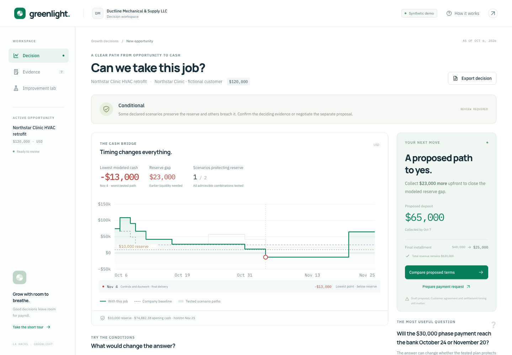
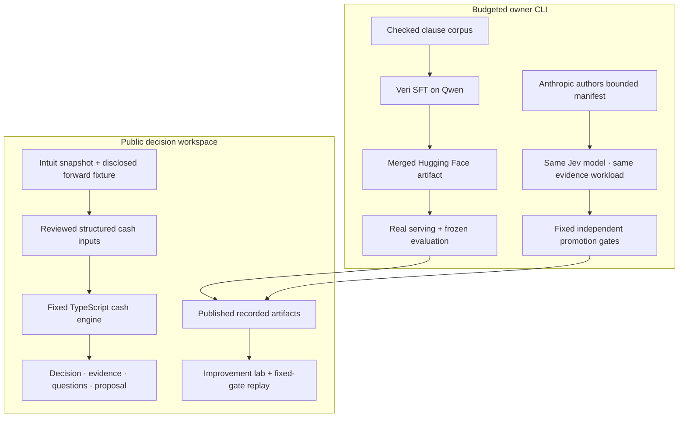

# Greenlight

**Can we accept this $120,000 job without borrowing or missing payroll?**

Greenlight turns that question into a traceable cash decision: the bottleneck, the evidence that could change it, and the smallest supported payment adjustment. Its MetaHarness measures improvements to repeated evidence processing while the financial engine remains fixed.

The application includes an interactive cash bridge, source evidence, bounded what-if controls, conserved funding proposals, and an improvement lab. The public demonstration runs deterministic calculations and displays recorded genuine provider experiments. It does not start paid inference or GPU jobs when someone visits or clicks Replay.

[Open Greenlight](https://greenlight-two-psi.vercel.app) · [Demo guide](docs/demo-guide.md) · [Domain and data provenance](data/scenarios/README.md) · [Provider/ML runbook](scripts/ml/README.md) · [Technical plan](docs/Greenlight-revised-plan.md)

**Team checkpoint:** start with the [team handoff](docs/TEAM-HANDOFF.md). The application runs without model-provider keys. The real v4 training and matched evaluation are complete; the tuned extractor was rejected by the frozen gate. [Actual results and next ML work](docs/extractor-v4-results.md).

**RAG preparation:** the [California small-business source pack](research/california/README.md) contains 33 official-source records and a [dataset-backed task map](research/california/backlog.md). It is a reviewed research handoff for the next feature; retrieval is not integrated into the app yet. The selected sponsor company is in New York, so California applicability must be established for a future job/business context.

**Design handoff:** [11 authored Paper artboards and a launch storyboard](docs/design/README.md) give the frontend team a complete visual direction without changing their working code. The [editable file](https://app.paper.design/file/01M56AKCMG8WN1327280QA4TJK) includes desktop/mobile directions, six frames for a 36-second film, tokens and motion notes.



## Try the decision

The default case is Ductline Mechanical & Supply's proposed $120,000 clinic HVAC retrofit. Existing commitments are included alongside the job's own costs.

- A $42,000 deposit, $30,000 phase payment and $48,000 final payment preserve the contract total.
- If the phase payment settles October 24, the lowest modeled cash is **$17,000**.
- If it waits until November 20, the lowest cash becomes **−$13,000**, breaching the $10,000 reserve by **$23,000**.
- The separately labeled proposal advances exactly **$23,000** from the final installment into the deposit: **$65,000 deposit, $30,000 phase, $25,000 final**. The worst modeled minimum becomes **$10,000**, with total revenue still **$120,000**.

Use **Compare proposed terms** to overlay the proposal. It remains conditional on customer agreement and the modeled settlement assumptions. **Prepare payment request** creates a draft; it does not send a message, execute an agreement, or move funds.

| Scenario | What to explore |
| --- | --- |
| Ductline · the $120k decision | Invoice eligibility and actual collection are different. One of two declared collection paths preserves the reserve. |
| Ductline · two small risks | Two $4,000 supplier overruns are safe individually; together they leave $9,000. Joint enumeration exposes the $1,000 gap. |
| Ductline · evidence gap | Conflicting acceptance and an unknown payroll-tax amount produce `NEEDS_INPUT`, even when a partial chart looks reassuring. |

The Evidence panel preserves source text, dates, references, hashes where available, and the distinction between sponsor records and constructed additions. What-if changes create a new versioned input; original fixture evidence stays intact. Decision snapshots can be downloaded with assumptions and proposal status.

## Run locally

Use **Node.js 22** and the checked-in lockfile. The public decision workspace and saved experiment replay work without model-provider keys.

```sh
npm ci --legacy-peer-deps
cp -n .env.example .env
npm run dev
```

Open [http://localhost:3000](http://localhost:3000). `cp -n` preserves an existing local `.env`. Fill credentials directly in that ignored file only if you intend to run owner operations or configure Sentry.

```sh
npm test
npm run typecheck
npm run build
npm start
```

The public application is deployed at [greenlight-two-psi.vercel.app](https://greenlight-two-psi.vercel.app). The health endpoint reports the current public execution mode; it does not certify model quality:

```sh
curl -s http://localhost:3000/api/health
curl -s -X POST http://localhost:3000/api/decision \
  -H 'Content-Type: application/json' \
  -d '{"scenarioId":"ductline-phase-delay"}'
```

## How the system fits together



**The cash engine has financial authority.** It uses integer cents, reconciles duplicate identities, computes the existing-business baseline and job together, and models outflows before inflows when same-day settlement order is unknown. It enumerates joint admissible scenarios, preserves witness paths, and blocks supported verdicts when material inputs, term semantics, horizon coverage or scenario coverage are incomplete. The initial exact enumeration limit is 256 cases; a partial family is never labeled exhaustive.

**The model roles are separate.** The Qwen extractor pipeline learns to map clauses into bounded typed obligations and uncertainty. Jev answers atomic semantic questions such as whether an inspection passed or a customer accepted a proposal. Anthropic authors a restricted workflow manifest. Neither a model judgment nor a promoted manifest can replace arithmetic, change evaluator labels, or activate an unsigned payment amendment.

**Payment stages and recipients are explicit.** Inspection plus customer receipt of a certificate may establish invoice eligibility. A term of fourteen calendar days **after invoice issuance** starts from the supplied issuance date: eligibility October 20 and issuance October 22 produce a November 5 due date. Missing issuance withholds that date, and neither eligibility nor due date creates bank settlement. A certificate received by a supplier does not establish receipt by the customer. The typed extractor preserves an explicit customer prerequisite; a clause requiring a contractor/supplier recipient is unsupported in this narrow vocabulary, while an unidentified recipient or unbound “we” is ambiguous. The deterministic payment-clock resolver connects reviewed rules to dates without automatically activating model output.

**The improvement loop is measured.** The candidate can change dependency caching, evidence scoping, batching and a constrained confidence threshold. The evaluator and workload are frozen separately from the author. Promotion requires no loss of correctness or decisive coverage, zero false `MET` judgments in the evaluated workload, and an improvement in quality or request count. Rejected results remain reportable.

## What the MetaHarness experiment actually measured

The recorded run uses `claude-sonnet-4-6` to author the bounded candidate and pinned `jev-1.14.0` for both workflows. Both baseline and candidate have caching. Seven synthetic evidence updates produce 21 judgments about inspection, certificate receipt and settlement confirmation.

| Recorded measurement | Baseline | Candidate |
| --- | ---: | ---: |
| Correct judgments | 20 / 21 | 20 / 21 |
| Decisive judgments, excluding `UNKNOWN` | 15 / 21 | 15 / 21 |
| False `MET` judgments | 0 | 0 |
| Jev requests | 18 | 6 |
| Input tokens | 12,666 | 3,998 |
| Measured workflow duration | 2,771 ms | 832 ms |

This is a **predeclared synthetic workload with localized evidence updates**, not a production speedup estimate or a large-scale accuracy benchmark. The one error remains visible: both runs returned `UNKNOWN` for a case labeled `CONFLICTING`. The preserved coverage matters because making fewer judgments would otherwise make a cheaper workflow look better. Costs in the run are conservative per-call rounded accounting, not an exact provider invoice.

The reviewable result, manifests, frozen workload hash and per-question predictions are in [harness-experiment.json](data/artifacts/harness-experiment.json). **Replay experiment** re-applies the fixed gates to that recorded provider run. It does not make new model calls.

## Fine-tuning evidence and release gates

A genuine **four-step SFT/LoRA proof on 16 examples** completed on `Qwen/Qwen3-4B-Instruct-2507` through Veri, exported [public synthetic merged weights](https://huggingface.co/machinelearningmo/greenlight-extractor-proof-931b140b-mvd2mcyp), and served a real canary. The canary failed schema validation: a single condition enum was returned as an array. This is technical train → export → serve evidence, with **no quality improvement claim**. No frozen final cases were queried in that proof.

The original **v3** substantive run completed **138 optimizer steps on 276 examples** and exported merged weights. Its subsequent base-model test returned 40 invalid answers under a shared prompt whose compact format example could be mistaken for an answer array. That prompt ambiguity prevents a clean quality claim; it does not establish the cause of every error. The diagnostic is [preserved](data/artifacts/legacy-v3-baseline.json) and excluded from the v4 comparison.

The **v4** experiment gives both models the validator's actual JSON Schema. It keeps the same 276 training contexts and labels, changes only the shared prompt contract, and uses a fresh independently authored 40-case final set. The actual Qwen tokenizer verifies every supervised row: **1,330 maximum total tokens**, at least **54 completion tokens**, exact prompt boundaries, and **zero truncation at 1,536**. A hash-bound token audit must pass before the training CLI can upload v4 data or allocate a GPU. Training completed all **138 steps**, with a committed checkpoint and [public merged model](https://huggingface.co/machinelearningmo/greenlight-extractor-sft-v4-2ae2030e-fed7b381-770). Exported tokenizer JSON and chat-template bytes match the pinned base files. Both real inference runs completed and their GPUs were permanently stopped.

| Evidence | Current reporting boundary |
| --- | --- |
| Historical four-step, 16-row technical proof | Trained, exported publicly, and served; canary schema-invalid. No final cases queried and no quality claim. |
| Substantive v3 extraction training | 276 rows, committed checkpoint at step 138; historical merged artifact preserved. |
| Legacy v3 baseline diagnostic | 0/40 valid answers under an ambiguous compact format example. Not used to claim an SFT gain. |
| Corrected v4 training | Same 276 labels, proper JSON Schema prompt, hash-bound tokenizer audit, committed checkpoint 138/138. [Recorded training proof](data/artifacts/training-v4.json). |
| Fresh matched 40-case v4 comparison | Completed and **rejected-regression**. The base is retained; no extraction quality gain is promoted. [All 80 actual outputs and scores](data/artifacts/extraction-evaluation.json). |

| V4 measurement | Base | Tuned |
| --- | ---: | ---: |
| Parseable JSON | 20 / 40 | 40 / 40 |
| Structural JSON Schema passes | 20 / 40 | 39 / 40 |
| Full validation: schema, references and completeness | 2 / 40 | 4 / 40 |
| Exact material interpretations | 0 / 40 | 1 / 40 |
| Correct supported proposals | 0 / 24 | 0 / 24 |
| Incorrect fully validated proposals | 0 | 3 |

The tuned pipeline improved formatting, but its one exact result was an unsupported clause; it produced no correct supported proposal and introduced three materially wrong trigger trees. The fixed gate rejected it. Neither extractor is ready for unattended contract interpretation. The public cash workspace continues to use reviewed structured fixtures. The source-bound C120 extraction also failed validation, so its invoice-clock preview is withheld. [Failure analysis](docs/extractor-v4-results.md) distinguishes syntax, structure, references and business checks rather than calling all failures malformed JSON.

The checked-in [v4 training manifest](data/training/v4-schema-contract/manifest.json) binds the supervised rows to the unchanged [v3 labels](data/training/manifest.json), publication policy, schema profile and hashes. The v4 final set is authored separately under `data/evaluation/v4-schema-contract/`. Labels derive from typed synthetic scenarios and developer review, not independent customer adjudication. Earlier versions remain archived as historical evidence. Only fictional clauses classified `PUBLIC_SYNTHETIC` may be uploaded or exported publicly; customer books, private documents, credentials and production traces are excluded.

The required extraction release gate is **`extractor-gates-v2`**. Coverage means **correct supported proposals divided by supported expected cases**. The recorded `proposed` and `unsafeProposed` counts apply only after full validation; the [diagnostic](data/artifacts/extraction-diagnostics.json) separately reports declared statuses from other parseable outputs. Promotion requires better material accuracy without weakening full validation, safe handling or correct supported coverage. Supported coverage is a relative safeguard, with no absolute usefulness floor when the base count is zero. The real result is **not promoted**. The complete artifact-pipeline comparison includes quantization/runtime differences and does not isolate LoRA's causal effect. See the [ML runbook](scripts/ml/README.md) and [frozen policy](docs/evaluation-policy.md).

## Owner CLI and spending boundary

Owner operations load `.env` locally. Anthropic, TypeSafe/Jev, Veri and Hugging Face keys are needed only for their corresponding private experiments. The public app does not import the spending ledger or expose paid execution routes. No Daytona or hosted sandbox account is required.

```sh
# Authentication/integration checks; no inference or GPU allocation.
npm run providers:smoke

# Read-only live resource and budget reconciliation.
npx tsx scripts/ml/reconcile.ts

# Read-only training plan and conservative cost preflight.
npx tsx scripts/ml/train-veri.ts --max-steps 4 --max-cents 600 --timeout-seconds 1800
```

The following commands **perform paid operations** and belong to the owner workflow. Reconcile resources and remaining authorization before executing them; the local durable ledger refuses reservations above the **$20 total project cap**. `--max-cents 600` reserves at most $6 for that operation, not an additional project budget.

```sh
# Real inference smoke test.
npx tsx scripts/ml/provider-smoke.ts --execute

# Anthropic-authored manifest + real baseline/candidate Jev replay.
npx tsx scripts/harness/experiment.ts

# Optional legacy technical proof; historical proof used 16 rows.
npx tsx scripts/ml/train-veri.ts --max-steps 4 --max-cents 600 --timeout-seconds 1800 --execute

# Substantive v4 training; requires the matching local tokenizer audit.
npx tsx scripts/ml/train-veri.ts --data data/training/v4-schema-contract/train.jsonl --name sft-v4 --max-steps 138 --max-seq-length 1536 --max-cents 600 --timeout-seconds 3600 --execute
```

For a technical serving check, use `scripts/ml/serve-evaluate.ts --canary-only` with the actual unique public synthetic repository emitted by training. It skips both final cases and the C-120 showcase. Final evaluation uses the same **40** frozen cases and decoding for base and tuned models, followed by `npx tsx scripts/ml/compare-evaluations.ts`. The showcase is separately scored and excluded from final metrics. Full commands and bounds are in the [ML runbook](scripts/ml/README.md). Keep private raw responses, resource records and the ledger under ignored `work/`.

Reservations survive errors and ambiguous outcomes. Training/serving creation is not blindly retried. Heartbeats, detached recovery guards, verified resource stopping, and retained reservations handle lifecycle failures. These controls do not invent a provider-side hard budget TTL or treat an unreported zero cost as proof that a GPU run was free. Existing Veri balance is not counted as extra spending authorization.

## Data, observability and implementation

The Intuit release supplies synthetic books. Greenlight preserves company-047's original source files and reconstructs **2,419 ledger rows to $74,882.38**, as of **October 6, 2026**. This bank balance becomes available cash only under the demo's explicit assumption of zero restricted funds. The forward calendar, reserve, clinic job, costs, contracts, communications and uncertainty bounds are constructed additions. It is not a live QuickBooks connection. [Pinned provenance](data/scenarios/intuit-source.json)

Sentry captured a real **oversized public-response defect**, with a readable first-party TypeScript frame, a trace and a structured log. The fix bounds public input, estimated calculation work and output size, and returns compact scenario summaries. The original development reproduction returned **83,662,869 bytes**; the production regression returned **428,167 bytes**, HTTP 200, while preserving all **256 scenario summaries** and the worst-case timeline. These are separate environment runs, not a latency benchmark. The issue is resolved.

Review the [captured issue](https://greenlight-full.sentry.io/issues/GREENLIGHT-FULL-2), [defect trace](https://greenlight-full.sentry.io/explore/traces/trace/36c873d3aa68496fa3648a7aa7575697), [production decision trace](https://greenlight-full.sentry.io/explore/traces/trace/cce2ff36a49a4f0ab0e87750fdf31dcd), [AI evidence trace](https://greenlight-full.sentry.io/explore/traces/trace/3d6174d05a49436c8534598d38fae12b), and [verified 51-second masked Session Replay](https://greenlight-full.sentry.io/explore/replays/2938f6342b1742e48e437e0cf48add8c/) with project access. Identifiers and measured regression sizes are also published in the artifact manifest. Source maps upload with each production build. The health flag reports DSN configuration only; the linked ingested records provide separate runtime proof.

The responsive application is implemented in Next.js/React. A separate [completed Paper design file](https://app.paper.design/file/01M56AKCMG8WN1327280QA4TJK) now provides 11 product, launch-storyboard and handoff artboards, with [PNG/JSX exports and implementation notes](docs/design/README.md). These are design references for the frontend team; the six-frame launch storyboard is not a rendered video. The earlier partial Paper canvas remains intact.

| Location | Responsibility |
| --- | --- |
| `app/`, `components/` | Decision, evidence and improvement interfaces; server routes |
| `lib/domain/` | Cash authority, scenario enumeration, proposals, sensitivities and Intuit adapter |
| `lib/harness/` | Bounded manifest, dependency keys, frozen workload and promotion gates |
| `lib/providers/` | Real model/training clients, typed extraction and evaluation |
| `lib/budget/` | Durable private owner spending authority |
| `scripts/ml/`, `scripts/harness/` | Reproducible provider, training, serving and experiment commands |
| `data/scenarios/`, `data/training/`, `data/artifacts/` | Disclosed fixtures, checked corpora and published run evidence |
| `tests/` | Financial counterexamples, provider failure paths, lifecycle, budget and API capacity |

The public API validates snapshots, bounds input size and estimated work, and returns compact scenario summaries with top-level witness timelines. Large or incomplete requests produce an explicit error or `NEEDS_INPUT` rather than an optimistic result.

## Practical limits

Greenlight demonstrates a bounded USD contractor workflow with supplied future commitments and text evidence. It cannot authenticate a document, resolve arbitrary legal precedence, discover omitted business obligations from historical books, or guarantee future settlement. Expected conditions and hypothetical answers remain visible assumptions. Supplier or job-start rescheduling requires a dependency schedule that the simple edit helper does not support.

The public demonstration does not automatically turn model extractions into active financial terms. Reviewed structured fixtures drive the cash workspace; genuine model runs and learned workflow changes are shown through versioned recorded artifacts. Model quality, production latency, customer adoption and prize outcomes must be established through evidence beyond this demonstration.
