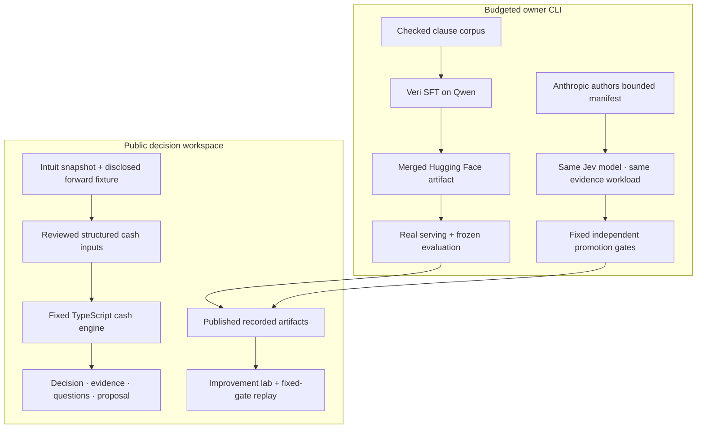

# Greenlight

**Can we accept this $120,000 job without borrowing or missing payroll?**

Greenlight turns that question into a traceable cash decision: the bottleneck, the evidence that could change it, and the smallest supported payment adjustment. Its MetaHarness measures improvements to repeated evidence processing while the financial engine remains fixed.

The application includes an interactive cash bridge, source evidence, bounded what-if controls, conserved funding proposals, and an improvement lab. The public demonstration runs deterministic calculations and displays recorded genuine provider experiments. It does not start paid inference or GPU jobs when someone visits or clicks Replay.

[Demo guide](docs/demo-guide.md) · [Domain and data provenance](data/scenarios/README.md) · [Provider/ML runbook](scripts/ml/README.md) · [Technical plan](docs/Greenlight-revised-plan.md)

## Try the decision

The default case is Ductline Mechanical & Supply's proposed $120,000 clinic HVAC retrofit. Existing commitments are included alongside the job's own costs.

- A $42,000 deposit, $30,000 phase payment and $48,000 final payment preserve the contract total.
- If the phase payment settles October 24, the lowest modeled cash is **$17,000**.
- If it waits until November 20, the lowest cash becomes **−$13,000**, breaching the $10,000 reserve by **$23,000**.
- The separately labeled proposal advances exactly **$23,000** from the final installment into the deposit: **$65,000 deposit, $30,000 phase, $25,000 final**. The worst modeled minimum becomes **$10,000**, with total revenue still **$120,000**.

Use **Compare proposed terms** to overlay the proposal. It remains conditional on customer agreement and the modeled settlement assumptions. **Prepare payment request** creates a draft; it does not send a message, execute an agreement, or move funds.

| Scenario | What to explore |
| --- | --- |
| Ductline · the $120k decision | Invoice eligibility and actual collection are different. One of two declared collection paths preserves the reserve. |
| Ductline · two small risks | Two $4,000 supplier overruns are safe individually; together they leave $9,000. Joint enumeration exposes the $1,000 gap. |
| Ductline · evidence gap | Conflicting acceptance and an unknown payroll-tax amount produce `NEEDS_INPUT`, even when a partial chart looks reassuring. |

The Evidence panel preserves source text, dates, references, hashes where available, and the distinction between sponsor records and constructed additions. What-if changes create a new versioned input; original fixture evidence stays intact. Decision snapshots can be downloaded with assumptions and proposal status.

## Run locally

Use **Node.js 22** and the checked-in lockfile. The public decision workspace and saved experiment replay work without model-provider keys.

```sh
npm ci --legacy-peer-deps
cp -n .env.example .env
npm run dev
```

Open [http://localhost:3000](http://localhost:3000). `cp -n` preserves an existing local `.env`. Fill credentials directly in that ignored file only if you intend to run owner operations or configure Sentry.

```sh
npm test
npm run typecheck
npm run build
npm start
```

The build supports Vercel deployment. A production URL should be taken from the verified release, not inferred from the repository name. The health endpoint reports the current public execution mode:

```sh
curl -s http://localhost:3000/api/health
curl -s -X POST http://localhost:3000/api/decision \
  -H 'Content-Type: application/json' \
  -d '{"scenarioId":"ductline-phase-delay"}'
```

## How the system fits together



**The cash engine has financial authority.** It uses integer cents, reconciles duplicate identities, computes the existing-business baseline and job together, and models outflows before inflows when same-day settlement order is unknown. It enumerates joint admissible scenarios, preserves witness paths, and blocks supported verdicts when material inputs, term semantics, horizon coverage or scenario coverage are incomplete. The initial exact enumeration limit is 256 cases; a partial family is never labeled exhaustive.

**The model roles are separate.** The Qwen extractor pipeline learns to map clauses into bounded typed obligations and uncertainty. Jev answers atomic semantic questions such as whether an inspection passed or a customer accepted a proposal. Anthropic authors a restricted workflow manifest. Neither a model judgment nor a promoted manifest can replace arithmetic, change evaluator labels, or activate an unsigned payment amendment.

**The improvement loop is measured.** The candidate can change dependency caching, evidence scoping, batching and a constrained confidence threshold. The evaluator and workload are frozen separately from the author. Promotion requires no loss of correctness or decisive coverage, zero false `MET` judgments in the evaluated workload, and an improvement in quality or request count. Rejected results remain reportable.

## What the MetaHarness experiment actually measured

The recorded run uses `claude-sonnet-4-6` to author the bounded candidate and pinned `jev-1.14.0` for both workflows. Both baseline and candidate have caching. Seven synthetic evidence updates produce 21 judgments about inspection, certificate receipt and settlement confirmation.

| Recorded measurement | Baseline | Candidate |
| --- | ---: | ---: |
| Correct judgments | 20 / 21 | 20 / 21 |
| Decisive judgments, excluding `UNKNOWN` | 15 / 21 | 15 / 21 |
| False `MET` judgments | 0 | 0 |
| Jev requests | 18 | 6 |
| Input tokens | 12,666 | 3,998 |
| Measured workflow duration | 2,771 ms | 832 ms |

This is a **predeclared synthetic workload with localized evidence updates**, not a production speedup estimate or a large-scale accuracy benchmark. The one error remains visible: both runs returned `UNKNOWN` for a case labeled `CONFLICTING`. The preserved coverage matters because making fewer judgments would otherwise make a cheaper workflow look better. Costs in the run are conservative per-call rounded accounting, not an exact provider invoice.

The reviewable result, manifests, frozen workload hash and per-question predictions are in [harness-experiment.json](data/artifacts/harness-experiment.json). **Replay experiment** re-applies the fixed gates to that recorded provider run. It does not make new model calls.

## Fine-tuning evidence and release gates

A genuine **four-step SFT/LoRA proof on 16 examples** completed on `Qwen/Qwen3-4B-Instruct-2507` through Veri and returned a merged Hugging Face export. That proves a real training/export operation; four steps cannot establish a useful extraction improvement.

The substantive release includes an invoice-issuance semantics review and a separate base-versus-tuned experiment. Final serving and quality claims must come from the completed artifacts, rather than from the proof job's completion status.

| Evidence | Current reporting boundary |
| --- | --- |
| Four-step, 16-row integration proof | Training completed; merged export returned. |
| Substantive extraction schema/corpus | Invoice-issuance behavior is being checked before the final comparison. |
| Pinned merged release and serving canary | Publish the verified artifact identity and actual inference result when complete. |
| Same-base, same-decoding held-out comparison | Publish exact case counts, errors, coverage, unsafe proposals and latency; retain the base on a tie or regression. No final gain is claimed here. |

The checked-in corpus manifest records the current splits and hashes. The initial corpus contains 192 supervised rows and a separate 24-case holdout, split by renderer family and company namespace. Labels derive from typed synthetic scenarios and developer review, not independent customer adjudication. A schema/corpus correction requires a new frozen release identity. See the [ML runbook](scripts/ml/README.md) for tokenizer checks, loss-mask evidence, artifact checks, lifecycle recovery, and the comparison gate.

## Owner CLI and spending boundary

Owner operations load `.env` locally. Anthropic, TypeSafe/Jev, Veri and Hugging Face keys are needed only for their corresponding private experiments. The public app does not import the spending ledger or expose paid execution routes. No Daytona or hosted sandbox account is required.

```sh
# Authentication/integration checks; no inference or GPU allocation.
npm run providers:smoke

# Read-only live resource and budget reconciliation.
npx tsx scripts/ml/reconcile.ts

# Read-only training plan and conservative cost preflight.
npx tsx scripts/ml/train-veri.ts --max-steps 4 --max-cents 600 --timeout-seconds 1800
```

The following commands **perform paid operations** and belong to the owner workflow. Reconcile resources and remaining authorization before executing them; the local durable ledger refuses reservations above the **$20 total project cap**. `--max-cents 600` reserves at most $6 for that operation, not an additional project budget.

```sh
# Real inference smoke test.
npx tsx scripts/ml/provider-smoke.ts --execute

# Anthropic-authored manifest + real baseline/candidate Jev replay.
npx tsx scripts/harness/experiment.ts

# Genuine proof training and merged export.
npx tsx scripts/ml/train-veri.ts --max-steps 4 --max-cents 600 --timeout-seconds 1800 --execute

# Substantive training; do not regenerate frozen data during an experiment.
npx tsx scripts/ml/train-veri.ts --data data/training/train.jsonl --name sft-v1 --max-steps 96 --max-cents 600 --timeout-seconds 3000 --execute
```

For serving, pass the **actual unique repository emitted by training** to `scripts/ml/serve-evaluate.ts`; run the same frozen cases with the base and tuned models, then run `npx tsx scripts/ml/compare-evaluations.ts`. Full commands and their bounds are in the [ML runbook](scripts/ml/README.md). Keep private raw responses, resource records and the ledger under ignored `work/`.

Reservations survive errors and ambiguous outcomes. Training/serving creation is not blindly retried. Heartbeats, detached recovery guards, verified resource stopping, and retained reservations handle lifecycle failures. These controls do not invent a provider-side hard budget TTL or treat an unreported zero cost as proof that a GPU run was free. Existing Veri balance is not counted as extra spending authorization.

## Data, observability and implementation

The Intuit release supplies synthetic books. Greenlight preserves company-047's original source files and reconstructs **2,419 ledger rows to $74,882.38**, as of **October 6, 2026**. This bank balance becomes available cash only under the demo's explicit assumption of zero restricted funds. The forward calendar, reserve, clinic job, costs, contracts, communications and uncertainty bounds are constructed additions. It is not a live QuickBooks connection. [Pinned provenance](data/scenarios/intuit-source.json)

Sentry instrumentation covers server decisions, workflow/model spans, structured logs, browser errors and masked Session Replay; source-map upload is configured when the build auth token is present. Snapshot, version and experiment identifiers connect calculations to their operational traces. The health endpoint's `sentryConfigured` flag reports DSN configuration, not verified ingestion. The release evidence must establish actual receipt of errors, traces and logs separately.

The interface began on a fresh [Paper canvas](https://app.paper.design/file/01M5653KWM6RPTEPWYPP37FKZX); the responsive application is implemented in Next.js/React. Further Paper MCP work encountered the account's weekly quota.

| Location | Responsibility |
| --- | --- |
| `app/`, `components/` | Decision, evidence and improvement interfaces; server routes |
| `lib/domain/` | Cash authority, scenario enumeration, proposals, sensitivities and Intuit adapter |
| `lib/harness/` | Bounded manifest, dependency keys, frozen workload and promotion gates |
| `lib/providers/` | Real model/training clients, typed extraction and evaluation |
| `lib/budget/` | Durable private owner spending authority |
| `scripts/ml/`, `scripts/harness/` | Reproducible provider, training, serving and experiment commands |
| `data/scenarios/`, `data/training/`, `data/artifacts/` | Disclosed fixtures, checked corpora and published run evidence |
| `tests/` | Financial counterexamples, provider failure paths, lifecycle, budget and API capacity |

The public API validates snapshots, bounds input size and estimated work, and returns compact scenario summaries with top-level witness timelines. Large or incomplete requests produce an explicit error or `NEEDS_INPUT` rather than an optimistic result.

## Practical limits

Greenlight demonstrates a bounded USD contractor workflow with supplied future commitments and text evidence. It cannot authenticate a document, resolve arbitrary legal precedence, discover omitted business obligations from historical books, or guarantee future settlement. Expected conditions and hypothetical answers remain visible assumptions. Supplier or job-start rescheduling requires a dependency schedule that the simple edit helper does not support.

The public demonstration does not automatically turn model extractions into active financial terms. Reviewed structured fixtures drive the cash workspace; genuine model runs and learned workflow changes are shown through versioned recorded artifacts. Model quality, production latency, customer adoption and prize outcomes must be established through evidence beyond this demonstration.
