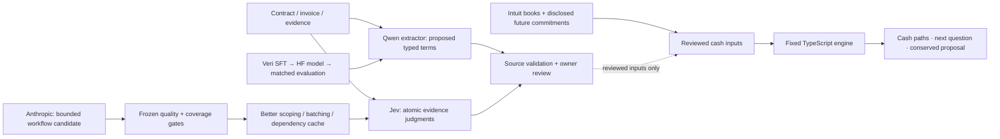

<div align="center">

# Greenlight

### Take the job. Protect payroll.

**An evidence-grounded cash decision for the small business owner's next big opportunity.**

[Live demo](https://greenlight-two-psi.vercel.app) · [3-minute presentation](docs/demo-guide.md) · [Architecture & evidence](#how-it-works) · [Run locally](#run-locally)

[](https://github.com/ManagementMO/greenlight/actions/workflows/ci.yml)


</div>


## A profitable job can still miss payroll

“Can we accept this **$120,000 job without borrowing or missing payroll?**”

The bank balance cannot answer that alone. Materials are paid before installation. Payroll arrives before the customer pays. Passing inspection may permit an invoice, but the invoice may be issued later—and its due date still is not cash in the bank.

Greenlight combines the company's existing commitments with a new job, tests the declared collection paths, and shows **what breaks, which evidence matters, and the smallest supported change that makes the plan work**.

| The default opportunity | Current terms | Proposed terms |
| --- | ---: | ---: |
| Deposit / phase / final payment | $42k / $30k / $48k | **$65k / $30k / $25k** |
| Contract revenue | $120,000 | **$120,000** |
| Worst modeled cash | −$13,000 | **$10,000** |
| Declared paths preserving the $10k reserve | 1 of 2 | **2 of 2** |

The proposal advances **$23,000** from the final payment into the deposit. The engine checks every declared path; one cent less misses the reserve. This is the minimum within the allowed payment-adjustment family, conditional on customer agreement and the modeled settlement assumptions.

## Try it in 90 seconds

1. **Open [the demo](https://greenlight-two-psi.vercel.app).** See the $120k decision and the −$13k worst cash point.
2. **Compare proposed terms.** Watch the cash bridge move to the $10k reserve while total revenue stays $120k. Open the draft payment request to see what needs agreement.
3. **Inspect Evidence.** Trace the Intuit bank snapshot and the clearly labeled constructed contract, commitments and collection assumptions.
4. **Switch to “two small risks.”** Two $4k surcharges are safe individually; together they leave $9k. Joint scenarios expose the gap.
5. **Switch to “evidence gap.”** Conflicting acceptance and missing employer-tax information produce `NEEDS_INPUT`. Unknown amounts are never silently treated as zero.
6. **Open Improvement lab → Replay experiment.** Recheck a genuine recorded Jev experiment against fixed gates.

Public decisions calculate in real time. Model results are labeled **recorded** and link to actual provider outputs. Demo clicks do not allocate GPUs, spend model credits, send requests to customers, or move money.

## How it works



**Interpretation learns; financial authority stays in code.** Qwen is trained to propose typed clauses with exact source IDs, explicit recipients, Boolean conditions, and separate invoice clocks. Jev answers small evidence questions. The cash engine uses integer cents, joint scenario enumeration, conservative same-day ordering, bounded work and explicit missing-input checks. A model result cannot activate a term by itself. The public workspace currently uses reviewed structured fixtures.

**Four events remain separate:** eligibility → invoice issuance → contractual due date → bank settlement. For a reviewed fourteen-calendar-day invoice rule, eligibility on October 20 and issuance on October 22 give a November 5 due date. Missing issuance withholds that date. None of those facts alone establishes collection.

**The MetaHarness improves the process around the model.** Anthropic proposes a small manifest controlling evidence scope, batching and dependency-aware caching. A separate evaluator checks the same frozen workload. The candidate cannot rewrite the evaluator, labels, source documents or cash arithmetic.

## What is measured

| Real recorded Jev experiment | Baseline | Candidate |
| --- | ---: | ---: |
| Correct judgments | 20 / 21 | **20 / 21** |
| Decisive judgments | 15 / 21 | **15 / 21** |
| False `MET` judgments | 0 | **0** |
| Provider requests | 18 | **6** |
| Input tokens | 12,666 | **3,998** |

Both workflows already cache. The candidate tracks which source dependency changed, scopes the relevant evidence and batches work. It passed the fixed gate on **seven synthetic evidence updates**. The remaining `CONFLICTING` → `UNKNOWN` error is preserved. This is one localized workload, not a general production benchmark. [Inspect the manifests, predictions and gate →](data/artifacts/harness-experiment.json)

The extractor has a separate quality gate. **V4 trained and served successfully but failed its final evaluation:** 0/24 correct supported rules, three incorrect validated proposals, and no promotion. All 80 base/tuned responses remain public. A new **v5** corpus addresses the observed nested-logic, status and reference-copying failures; its result will be reported only after actual training and fresh evaluation. [V4 results](docs/extractor-v4-results.md) · [V5 experiment protocol](docs/extractor-v5-protocol.md)

Sentry led to a concrete fix: a small input expanded into an **83,662,869-byte response**. The repaired endpoint returned **428,167 bytes** in the production regression while preserving all 256 scenario summaries and the worst-case timeline. These are separate-environment measurements, not a latency comparison. [Captured issue](https://greenlight-full.sentry.io/issues/GREENLIGHT-FULL-2) · [Trace](https://greenlight-full.sentry.io/explore/traces/trace/36c873d3aa68496fa3648a7aa7575697)

## Built with the sponsors

| Integration | Its job in Greenlight | Inspect it |
| --- | --- | --- |
| **Intuit data** | Reconstruct 2,419 synthetic ledger rows to **$74,882.38**; anchor a small-business decision in source records. | [Pinned provenance](data/scenarios/intuit-source.json) |
| **Veri** | Actual QLoRA training, merged model export, real serving, budgeted evaluation and verified GPU cleanup. | [ML runbook](scripts/ml/README.md) |
| **TypeSafe / Jev** | Repeated atomic evidence judgments, with measured batching and dependency-cache improvements. | [Experiment](data/artifacts/harness-experiment.json) |
| **Sentry** | Source-mapped errors, traces, structured logs, AI spans and masked Session Replay; a real defect diagnosed and repaired. | [Evidence tour](docs/demo-guide.md) |
| **Paper** | Eleven product and storyboard artboards, design tokens, JSX exports and engine-derived chart points. | [Editable design](https://app.paper.design/file/01M56AKCMG8WN1327280QA4TJK) · [Handoff](docs/design/README.md) |

Paper's six launch frames are a storyboard, not a rendered film. The live application screenshot above shows the implemented UI.

## Run locally

Use **Node.js 22**. The decision workspace and recorded experiment replay work without provider keys.

```sh
git clone https://github.com/ManagementMO/greenlight.git
cd greenlight
npm ci --legacy-peer-deps
cp -n .env.example .env
npm run dev
```

Open [localhost:3000](http://localhost:3000). Keep any existing `.env`; credentials belong only in that ignored file.

```sh
npm test
npm run typecheck
npm run build
npm start
```

```sh
curl -s http://localhost:3000/api/health
curl -s -X POST http://localhost:3000/api/decision \
  -H 'Content-Type: application/json' \
  -d '{"scenarioId":"ductline-phase-delay"}'
```

## Owner CLI and spending boundary

Paid operations run locally through a durable ledger with a **$20 total project cap**, explicit reservations, timeouts, recovery guards and GET-verified permanent stopping. Provider keys are never required by public demo visitors. No Daytona account is needed.

```sh
# Read-only integration and resource checks; no inference or GPU allocation.
npm run providers:smoke
npx tsx scripts/ml/reconcile.ts
```

Use the [owner runbook](scripts/ml/README.md) for training, serving and reproducible experiments. Do not start a second paid run while another teammate owns an active GPU. Keep private records under ignored `work/` and preserve frozen historical results.

## Data and scope

The books come from **Intuit's synthetic release**, not a live QuickBooks connection. Company-047's reconstructed bank balance is dated October 6, 2026. Treating all of it as available cash is an explicit zero-restricted-funds assumption. The future commitments, clinic job, contracts, communications and uncertainty bounds are constructed additions. [Full provenance →](data/scenarios/README.md)

Greenlight supports a bounded USD contractor workflow. It does not discover every omitted obligation, authenticate documents, resolve arbitrary legal terms or guarantee settlement. Payment proposals remain drafts requiring agreement and collection.

## For teammates and judges

| Start here | What it contains |
| --- | --- |
| [Presentation guide](docs/demo-guide.md) | Operator cues, exact spoken lines and answers to technical questions |
| [Submission narrative](docs/submission.md) | Problem, implementation, sponsor demonstrations and scope |
| [Team handoff](docs/TEAM-HANDOFF.md) | Setup, ownership and independent work areas |
| [Design system and launch storyboard](docs/design/README.md) | Paper exports, tokens, motion notes and real chart geometry |
| [California source pack](research/california/README.md) | 33 official-source records and six dataset-backed task ideas; retrieval is not yet integrated |
| [Model improvement handoff](docs/model-improvement-handoff.md) | Failure analysis and the path to useful extraction |

The California pack requires a jurisdiction check: the selected sponsor company is in New York. Next product work is cited obligation discovery and invoice-to-bank evidence, alongside the frontend team's Paper implementation. The current source corpus is preparation, not a claimed live RAG system.

<details>
<summary>Repository map</summary>

| Path | Responsibility |
| --- | --- |
| `app/`, `components/` | Decision, evidence, improvement views and bounded server routes |
| `lib/domain/` | Cash authority, joint scenarios, payment clocks, proposals and book adapter |
| `lib/harness/` | Bounded workflow manifests, dependency keys and promotion gates |
| `lib/providers/` | Provider clients, typed extraction and evaluation |
| `lib/budget/` | Private durable spending ledger |
| `scripts/ml/`, `scripts/harness/` | Reproducible owner experiments |
| `data/` | Disclosed fixtures, checked corpora and actual published results |
| `tests/` | Financial counterexamples, provider failures, lifecycle and capacity regressions |

</details>
