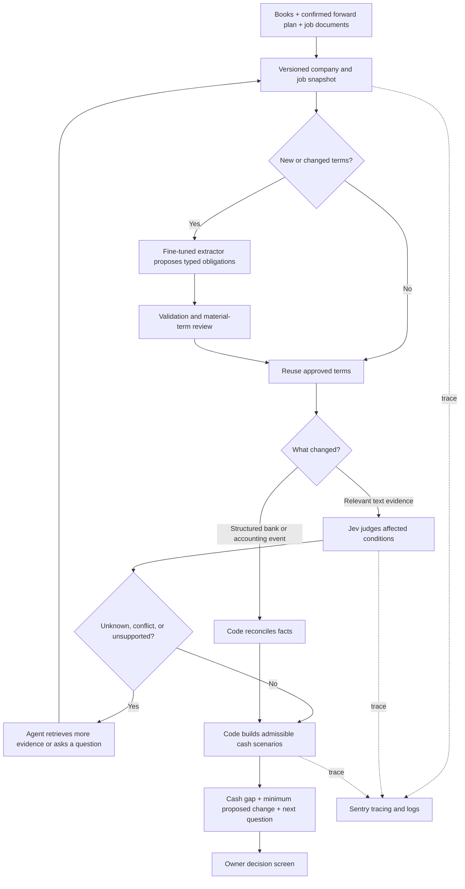
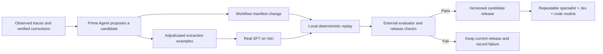

# Greenlight: revised system and adversarial feasibility audit

**Execution settings confirmed:** product name Greenlight, local project `/Users/mo/Downloads/greenlight`, Anthropic for the general model, and one Sentry organization with a project named `greenlight-full`. The public GitHub repository is [ManagementMO/greenlight](https://github.com/ManagementMO/greenlight). The hosted demonstration has an initial $20 out-of-pocket cap across project services. Credentials live in the project's ignored `.env`. Sponsor credits must be verified separately. Workflow replay runs locally; no hosted sandbox service or key is required. See [setup checklist](./Greenlight-setup-checklist.md) for outstanding accounts and credentials.

Prepared October 17, 2026. This replaces the earlier time-boxed proposal. Scope is chosen for correctness, customer value, and testability, not a hackathon deadline. This is a proposed implementation: public documentation/source inspection and ten local deterministic design probes are complete; live provider calls, training, serving, and application integration are not.

## Decision

Build **Greenlight: a job-funding decision system that identifies the evidence and payment changes needed to take a job without breaching a cash reserve.** Its MetaHarness improves the repeatable evidence-processing workflow through measured experiments and actual fine-tuning.

Keep the owner’s question: **“Can we accept this $120,000 job without borrowing or missing payroll?”** Answer with the cash bottleneck, the conditions the answer depends on, the most useful clarification, and a specific funding proposal. A future forecast is conditional on its inputs; the system must expose those conditions rather than turn them into a guarantee.

The central technical claim is narrower and testable: after the system has learned a class of evidence-processing tasks, repeated updates can use a specialized extractor, Jev judgments, and ordinary code with less general-agent work. Whether that actually improves quality, latency, or cost must be measured. Engineering the loop is feasible; useful learned improvement is an experimental result.

## What the audit changed

| Hidden assumption | Why it breaks | Revised contract |
| --- | --- | --- |
| Historical books contain the future plan | Future payroll, taxes, job spending, and payment dates are not fully established by prior transactions | Require a confirmed forward cash calendar and job budget; missing inputs produce a visible incomplete result |
| Satisfying a payment condition means cash arrives | Eligibility, invoicing, due date, collection, and bank settlement are different events | Model them separately; future settlement dates remain explicit assumptions unless already observed |
| An LLM can interpret arbitrary contracts into executable truth | Correct JSON and existing citations do not prove faithful interpretation | Support a bounded clause vocabulary; stage extracted terms for material-term review; preserve ambiguity and unsupported clauses |
| Jev learns the workflow through fine-tuning | Jev currently uses shared weights, with customization through request context/questions | Fine-tune an open model for extraction; use Jev for atomic semantic judgments; implement workflow execution in code |
| A trained LoRA model is automatically deployable | A standalone adapter needs its base model; Veri documents a direct-deployment rejection for LoRA checkpoints | Prove a train → merge → export → serve path, or explicitly validate its beta adapter-serving alternative |
| More successful traces automatically make good training data | Success can be accidental; financial facts change; models can agree on the same mistake | Use adjudicated labels and accepted source interpretations, not raw success logs as truth |
| A sandbox gives a realistic business simulator | Isolation supplies compute boundaries, not truthful contracts, customers, or cash behavior | Build deterministic stateful fixtures and a separate evaluator; external events have explicit rules |
| Individually safe risks imply a safe combination | Two small overruns or delays may jointly breach the reserve | Evaluate joint admissible scenarios and disclose scenario coverage |
| An improvement agent can decide whether its own changes work | It can optimize evaluator wording, leak answers, or abstain on every hard case | Freeze the evaluator, financial engine, and action permissions; compare quality at matched coverage and report fallbacks |
| Faster model inference guarantees a faster product | Extraction, repeated API calls, retries, cold starts, and investigation may dominate | Cache stable terms; re-evaluate only affected conditions; benchmark the whole user request |

## Product boundary

The initial supported business is a commercial HVAC, electrical, or solar supply-and-install contractor. Support USD, explicit job-cost schedules, a small number of milestone payments, and textual evidence. These restrictions define a domain where interpretation and cash consequences can be checked.

Supported payment conditions include an agreed deposit, delivery, phase acceptance, inspection result, certificate receipt, and invoice acceptance. Support bounded AND/OR combinations and explicit calendar-day payment terms. Unsupported statutory terms, disputed legal precedence, image-only documents, unspecified business-day calendars, or unrepresentable clauses remain visible unresolved items. They are not silently approximated.

The owner supplies or confirms three things:

1. **Available cash and existing commitments:** as-of timestamp, usable settled funds, reserve policy, remaining bills, payroll and other cash outflows, expected incoming cash, and coverage through the selected horizon. Restricted funds and unavailable balances are excluded explicitly. Unknown amounts and dates are not zero.
2. **The proposed job:** total price, timed costs, milestones, allowed negotiating ranges, and relevant dependencies. Historical averages can prefill suggestions, but the accepted plan records which inputs the owner confirmed.
3. **Terms and evidence:** contract text, accepted amendments, invoices, inspection messages, and relevant customer communications, each with a source identity and date.

The system may prefill these inputs. The confirmation is necessary because an accurate interpretation of incomplete books can still yield a wrong recommendation. It is a product step, not a claim that a model can know future obligations.

Outputs are a dated cash timeline, reserve gap, critical condition, proposed adjustment, required agreements, and evidence/assumption trail. The product prepares decisions and drafts proposed changes. Transferring money, accepting a job, or executing a contract is outside this implementation’s authority.

## Runtime architecture



The data adapter, financial engine, event reconciliation, and question ranking are services. They do not require their own autonomous agents. A general reasoning agent investigates exceptions through a small set of typed tools; it cannot overwrite arithmetic or promote its own answer.

### State and data contracts

Keep these as explicit, versioned records rather than a giant conversation history:

- `Snapshot`: company/job scope, as-of time, source hashes, opening available cash, remaining commitments, forward-plan coverage and confirmation, schema version.
- `Evidence`: immutable source ID and hash, span IDs, effective/observed dates, document type, party identity, job/milestone identity, and supersession links. Text that claims to be an instruction remains document content.
- `Obligation`: amount or validated amount reference, payer/payee, trigger tree, due-date rule, relevant milestone, sources, interpretation status, and review record.
- `Judgment`: one proposition, MET / NOT_MET / UNKNOWN / CONFLICTING, source references, model version, request hash, and confidence output. UNKNOWN means insufficient evidence; NOT_MET requires evidence for the negative under the question’s defined semantics.
- `Scenario`: assumed future events, permitted timing/amount ranges, agreements required, and uncertainty coverage.
- `Decision`: input version, status, baseline and with-job cash paths, cash minima, reserve gaps, candidate changes, next question, and assumptions.
- `Release`: exact extractor artifact, harness configuration, Jev version, schemas, evaluator version, and data hashes.

The current-bank balance is a stock as of a timestamp. Only movements not already in it enter the future cash path. Reconcile invoices, payments, bank transactions, bills, and payroll using explicit source links. Reject ambiguous duplicates; do not join different companies merely because their invoice IDs match.

Apply each event idempotently. If a source sends the same identity with conflicting content, require a correction/supersession record. Discard or recompute asynchronous model responses whose snapshot version is stale. Cache by company, evidence hashes, relevant terms, schema, and model/harness versions.

### Fine-tuned extractor: what it learns

Use a small open instruct model, with **Qwen3-4B-Instruct-2507 as an initial candidate**, subject to provider/model compatibility checks. It learns to map relevant text and visible reference tables to our typed obligation schema, including ambiguity and unsupported cases. It does not learn the customer’s cash balance or financial arithmetic.

Example training pair:

```text
INPUT
Contract C17, span 8:
"Thirty thousand dollars becomes payable fourteen calendar days
 after phase-one inspection has passed and the insurance
 certificate has been received."
Visible references: phase_1, job_17, amount_C17_8 = USD 30,000.

TARGET (illustrative schema)
amount_ref: amount_C17_8
trigger: ALL(inspection_passed(phase_1), certificate_received(job_17))
due_rule: trigger_time + 14 calendar days
sources: [C17:s8]
interpretation: PROPOSED
```

If the passage does not establish who receives the certificate or what “completion” means, the target must include that unresolved field. Do not train the model to guess it. Code parses scalar amounts, resolves references, checks currency/parties, and rejects invalid trees. Material new terms are staged for review before activation. Source checks alone do not certify semantic correctness.

The training set combines independently checked typed scenarios, varied natural-language renderings, manually reviewed difficult examples, and adjudicated extraction failures from the system. Generate the underlying scenario before its prose, but review that the prose actually expresses the label. Add contradictions, negation, revised clauses, irrelevant neighboring milestones, missing dates, and unsupported language. Do not use Jev agreement as ground truth.

Split by company, document family, and semantic template before generating variants. Near-paraphrases of the same clause must not appear on both sides. Keep an independently authored final evaluation set inaccessible to the improvement agent. The Intuit books provide financial context; they are not already a labeled contract-extraction corpus.

Training changes model weights with SFT/LoRA. Workflow prompt edits are a separate improvement mechanism. Training data volume and epochs are chosen from learning curves and held-out errors, not a promise that a fixed number of examples will help. Compare the same base model before and after tuning, with the same schema, retrieval, and decoding settings.

### Train-to-serving path: an early proof gate

Veri supports SFT and LoRA, but its deployment API documents that directly deploying a LoRA training job or saved adapter as a standalone model fails. The default planned path is:

1. Prove a base-model request with the intended tokenizer and structured-output format.
2. Run a small genuine SFT job on checked examples to exercise the full artifact path.
3. Request a merged export with `hf_push.artifact = "merged"` to a configured Hugging Face repository.
4. Check the export result and artifact contents. Training can complete even if export fails.
5. Deploy the merged repository, verify that it reaches serving state, and inspect a known canary’s response and the loaded artifact identity.
6. Only then perform the substantive training/evaluation run and deploy a pinned release.

A private-repository export does not by itself prove the serving worker can read that repository. Verify authentication on the full path. Do not make a private artifact public merely to bypass an integration problem. Veri’s beta multi-adapter fleet is an alternative, requiring explicit base/adapter compatibility and its API-specific setup; it is not assumed interchangeable with ordinary deployment.

Pin immutable release repositories or an otherwise verified immutable artifact. A mutable HF repository name and a cached model can serve different weights than expected. Verify base revision, tokenizer, chat template, adapter compatibility, exported files, and actual loaded release. Confirm the effective training loss mask and truncation in the runner: a provider accepting a format does not prove it used the intended assistant/completion-only objective.

Structured-output configuration is engine-dependent. Validate actual returned JSON and meaning regardless of whether constrained decoding is supported. Handle timeouts, rate limits, and scaled-to-zero wake responses. Warm-deployment and cold-start latency must be reported separately.

Sources: [Veri SFT](https://docs.veri.studio/training/sft), [deployment API](https://docs.veri.studio/deployments/api), [Hugging Face export](https://docs.veri.studio/training/huggingface), [OpenAI-compatible serving](https://docs.veri.studio/deployments/openai-compat), [pinned training runner](https://github.com/Veri-Studios/veri-runner/blob/7b876fcf3a511bfb5eca037eeb4860f39e633973/veri_runner/training_runtime.py), [Qwen model card](https://huggingface.co/Qwen/Qwen3-4B-Instruct-2507).

### Jev: its useful, limited job

Jev answers atomic questions about unstructured evidence: “Does this inspection report establish that phase one passed?” or “Does this customer message explicitly accept this proposed payment schedule?” The request contains the relevant approved term, applicable evidence, entity identities, and precise criteria. Batch related questions when the shared context is appropriate.

Code first validates scope, dates, identities, and document precedence. A newer email does not automatically override a signed amendment. Jev’s label is a model judgment, not a certification of authenticity or legal authority. Use an explicit evidence policy, evaluate abstention thresholds on development data, and return uncertainty when material evidence conflicts. The routine can update a provisional forecast automatically; activation of new material contract terms retains the review step.

A trusted structured bank settlement should be handled by code directly. Jev is unnecessary for checking `settled_amount >= required_amount`. Its value is interpreting relevant language repeatedly without invoking a broad reasoning agent for every change.

Jev currently is not fine-tuned per customer. The trained open model and Jev have different jobs. Jev’s confidence output is not a probability that an invoice will be paid, an estimate of business risk, or the expected dollar value of a clarification. Pin the evaluated Jev model version rather than silently following a changing alias. Sources: [Jev models/customization](https://docs.typesafe.ai/models), [confidence semantics](https://docs.typesafe.ai/confidence), [building with System One](https://docs.typesafe.ai/concepts/how-to-build-with-system-one).

### Financial engine and the useful question

For each admissible scenario, compute event-level cash in integer cents:

`cash(t) = available_cash_at_snapshot + settled_or_assumed_inflows_through_t - remaining_outflows_through_t`

`reserve_gap = max(0, required_reserve - minimum_cash)`

Compute both the existing-business baseline and the baseline plus proposed job. If the baseline already breaches the reserve, expose it rather than blaming the job for the entire shortfall.

Separate the stages of each receivable: condition satisfied → invoice eligible → invoice issued → due → assumed collection → observed bank settlement. Future collections require stated date/range assumptions. If there is no defensible finite bound, show incomplete coverage instead of an invented guaranteed receipt.

Use known intraday order when available. Otherwise model outflows before inflows on the same day for the conservative check, while showing the assumption. Extend the horizon through known job obligations and the stated business-calendar coverage. Do not hide a late bill by ending the chart early.

Enumerate joint admissible scenarios for the supported small set of uncertainties, respecting dependencies. The initial implementation caps exact enumeration at 256 scenarios. If more are required, request narrower input bounds or show incomplete coverage; a sampled subset cannot be labeled exhaustive. Report that “all scenarios pass” refers only to the disclosed scenario family.

Allowed initial proposal levers are an agreed amount of existing contract revenue collected earlier and an explicit revised milestone collection date. Supplier timing changes can be evaluated only when their dates and downstream effects are supplied. Starting later requires an explicit dependency schedule; moving one cost without moving affected milestones is invalid.

When increasing an early deposit, reduce later receipts by the same amount and enforce the contract total and negotiation bounds. Search integer-cent adjustments with full re-simulation. A reserve gap equals the required deposit increase only if advancing that revenue can repair the relevant deficits; a deficit after the offsetting final payment may be impossible to fix this way. Report “minimum within this allowed proposal family,” not a globally optimal contract.

To choose a question, branch on its possible answers while preserving the other joint uncertainties. Rank questions by whether they distinguish feasible from infeasible plans, then by their effect on worst-case reserve gap, then by the earliest affected bottleneck. Keep witness scenarios behind the ranking. Also display a required-by date and who could answer. This is deterministic decision sensitivity, not expected monetary value without a probability model.

Provisional output states, in precedence order:

1. `NEEDS_INPUT`: missing/conflicting material inputs, unsupported critical terms, or incomplete scenario/horizon coverage. Show partial calculations without a green verdict.
2. `SHORTFALL`: all enumerated admissible scenarios for the current plan breach the reserve. Show the range and candidate fixes.
3. `CONDITIONAL`: some scenarios pass and some fail. Show the deciding uncertainty and required agreements.
4. `SUPPORTED_IN_TESTED_SCENARIOS`: every enumerated scenario passes under complete declared coverage. Future assumptions remain visible.

A hypothetical changed contract is evaluated separately from the current plan and labeled “proposal.” A passing proposal never silently changes the current job’s status.

## MetaHarness: real self-improvement with a defined target

Start with one workflow: **reassess a job when relevant evidence changes**. The initial general agent can retrieve documents, propose typed interpretations, request missing inputs, and invoke the cash engine. Repetition reveals which steps are reusable.



Prime Agent is the experiment author. Use its workspace/refinement capabilities to propose bounded manifest changes, which a fixed local runner validates and executes. If a later experiment executes candidate code, use a disposable local container with a narrow tool interface; do not run arbitrary candidate code in the host evaluation process. Its built-in REPL is not a security isolation boundary. It is not a prebuilt compiler for financial business processes. Source: [Prime Agent](https://github.com/PrimeIntellect-ai/prime-agent).

The mutable workflow manifest controls retrieval filters/context selection, prompts, Jev question wording with fixed label meanings, batching, and selection among existing typed tools. It can propose new code changes separately, but they require normal engineering review and fixed tests before deployment. It cannot edit the cash engine, label definitions, evaluation answers, company permissions, source-authority policy, or release gates.

An example improvement: the original workflow repeatedly overlooks the certificate requirement in a multi-condition clause. First establish whether the failure was extraction, retrieval, or evidence classification. A retrieval fix belongs in the harness. A genuinely misread clause produces a reviewed SFT example. A Jev classification error calls for improved question context/criteria or abstention behavior. Do not train the extractor merely because another component failed.

The learned routine can become: load approved obligations → identify conditions affected by this event → retrieve their evidence → batch atomic Jev judgments → run the fixed scenario solver → return the next question. This transfers a repeatable process to a cheaper specialized path while preserving a general agent for exceptions. It does not transfer all reasoning into Jev’s weights.

The local replay runner evaluates candidates against resettable stateful fixtures and controlled tool interfaces. Initial candidates are validated declarative manifests interpreted by fixed code. The evaluator lives outside candidate write access; protected answer keys and future hidden events are not available to the candidate. For any code-executing experiment, use a disposable local container without evaluator data, host credentials, or a mounted Docker socket, and restrict network access. Reset logical application state and clocks between runs, not merely process memory. Simulated customers follow documented fixture rules; a model that helpfully agrees to every negotiation is not a valid environment.

## Evaluation: how we know whether the idea works

There are two different claims to establish: the product computes useful, correct conditional funding decisions; and specialization/improvement makes evidence processing better or cheaper. Do not let the second substitute for the first.

Use these baselines with the same available facts, financial calculator, and permitted tools:

- Deterministic structured-input system, showing how much of the problem needs no model.
- A capable general LLM/agent doing extraction and evidence judgment.
- The untuned candidate open model.
- The tuned open model, then the tuned extractor plus Jev workflow.
- The accepted fixed workflow versus a MetaHarness candidate under equal experiment budgets.

Ablate Jev and fine-tuning separately. Otherwise any improvement cannot be attributed to either. Cache equivalent stable work in all baselines; do not compare a cached specialist to an intentionally wasteful agent that rereads everything.

Measure material extraction errors, false satisfied conditions, appropriate uncertainty, funding-status correctness, required-adjustment error, and whether recommended questions actually discriminate downstream outcomes. Also measure coverage, owner review burden, fallback rate, total model calls, end-to-end p50/p95 latency, and cost. Include retries, active GPU hosting, amortized training, and failed experiments when claiming economics. State warm/cold behavior and actual test workload.

All deterministic invariants and safety-critical curated cases must pass. Freeze thresholds and evaluation definitions before looking at final results. Select candidates using training/development data; use a protected final set for the frozen release claim. Repeated exposure to the same final set turns it into development data, requiring a new protected set. Record failed candidates too.

Do not promote a change that appears more accurate merely because it refuses most questions. Compare at matched coverage/review burden, or publish the full tradeoff. If a tuned model or Jev adds cost without improving the quality/latency tradeoff, retain the working baseline and report the result. A valid SFT run is real fine-tuning; it does not by itself establish a useful fine-tuning result.

## Data reality and the demonstration

The Intuit release supplies synthetic accounting records and permits disclosed extensions. It is not a live QuickBooks connection. It lacks the complete contract/email/inspection corpus and confirmed future operational plan needed here. Source: [Intuit brief](https://docs.google.com/document/d/1JGmvJvZugbFrJW2WSrrPF96r_wB_xaMkfqVM49LE4nU/edit), [provided dataset](https://huggingface.co/datasets/CL251215/QuickBooks-Hackathon-2026/tree/main).

Inspection of company-047, Ductline Mechanical & Supply LLC, found a final bank running balance of $74,882.38 at the dataset’s 2026-10-06 end, five projects, and no estimates. Payroll records are marked gross-only. Therefore the previous illustrative $25,000 opening cash and new $120,000 job must not be presented as an untouched example from that company. Create a disclosed candidate-job fixture, confirm a forward cash calendar, and reconcile the actual opening available funds.

Keep sponsor records, added scenario documents, and generated training examples visibly separate. At earlier replay dates reconstruct as-of information; do not expose future payments, final statuses, hidden simulation state, or labels to models. Align the demo clock to the snapshot rather than silently treating old records as current.

The small worked example below is entirely constructed to explain the mechanism. It excludes other company obligations, which the actual product must include:

- Available cash $25,000; reserve $10,000; job price $120,000.
- Original job: materials $50,000 on day 2, labor $15,000 on days 7 and 21, all revenue on day 45. Minimum cash is **−$55,000**, despite a $40,000 contribution before other expenses.
- Proposed schedule: $42,000 deposit on day 0; $30,000 collected at phase one on day 14; $48,000 final on day 45; materials split $25,000 on days 2 and 25. Minimum cash is **$17,000** if all those assumptions hold.
- If the phase payment instead arrives day 45, minimum cash is **−$13,000**. Preserving the reserve needs **$23,000** more early liquidity.
- If permitted and actually collected, moving $23,000 from the final installment into the deposit raises the deposit to $65,000 and reduces the final installment to $25,000, while the phase installment remains $30,000. Minimum cash becomes **$10,000**. Total revenue remains $120,000. This proposal still requires agreement and the modeled settlement timing.

The compelling demonstration is to change the evidence and see the cash consequence change: permission to bill is established, but the stated collection date is too late; the system locates the precise bottleneck and proposes the smallest permitted advance. Then repeat with a genuinely held-out wording and show measured workflow behavior before/after a verified improvement.

### Local adversarial probes completed during this audit

Ten deterministic cases passed their explicit expected outcomes in a standalone scratch calculation. They are design evidence, not an implemented application test suite or validation of either model.

| Probe | Observed result | Requirement it establishes |
| --- | --- | --- |
| Profitable job paid late | Minimum −$55,000, ending $65,000 | Evaluate timing, not just final profit |
| Revised early collections | Minimum $17,000 | Preserve the exact assumptions behind a passing plan |
| Delayed phase collection | Minimum −$13,000 | Separate permission to invoice from collection |
| Same-day payroll and receipt | Daily close $10,000; intraday minimum −$5,000 | Model settlement order |
| Two $4,000 stresses | Either alone: minimum $13,000; both: $9,000 | Test joint scenarios against the $10,000 reserve |
| Deposit acceleration | $23,000 earlier restores $10,000 minimum; final cash unchanged | Conserve total revenue |
| Omitted other payroll | Minimum falls from $17,000 to $5,000 | Require future company commitments |
| Duplicate event delivery | No change in cash | Idempotent reconciliation |
| Conflicting duplicate | Explicit rejection | Require correction handling |
| Known cost beyond horizon | Explicit incomplete-horizon rejection | No artificial feasibility from ending early |

## Build plan ordered by proof, not time

### Gate 1 — Financial input contract and reference scenario

Implement the Intuit adapter, provenance, as-of snapshot, confirmed forward calendar, and typed job specification. Use manually approved terms first. Reconcile a selected company and disclose all added fixtures. Done when an independent person can trace opening cash and every remaining modeled movement to a source or an explicit assumption. Unknowns must survive ingestion as unknowns.

### Gate 2 — Correct decision engine

Implement event ordering, cash baseline, joint scenarios, status precedence, question sensitivity, and bounded deposit/date proposals. Test invariants and independently calculated counterexamples, including the ten audit cases. Done when amounts conserve value, changes remain proposals, and incomplete inputs cannot produce a green result. The engine must remain useful with manually entered structured terms.

### Gate 3 — Provider integration and actual trained artifact

Prove real Jev requests and the complete open-model SFT → merged export → serving path with a small checked training set. Validate response schemas, actual artifact identity, version pinning, private-repo access, retries, and cold-start behavior. Done when the app can call the genuinely trained artifact; a dashboard saying “training complete” is insufficient.

### Gate 4 — Evidence interpretation with honest uncertainty

Build the reviewed extraction corpus, data splits, term activation screen, atomic Jev questions, conflict handling, and general-agent fallback. Run base/tuned/general-model comparisons. Done when source identity, semantic error, abstention, and fallback behavior are measurable, and ambiguous evidence cannot silently become settled cash.

### Gate 5 — A real improvement experiment

Instrument one repeated evidence-update workflow. Have Prime Agent propose a bounded improvement, replay it with the local runner, and evaluate outside its write access. Route adjudicated extraction failures into a real SFT batch. Publish base versus candidate results and promote only if predeclared quality/coverage and performance gates pass. Done means the loop executes correctly and reports its result; useful improvement is claimed only if measured.

### Gate 6 — Product and sponsor evidence

Build one polished decision screen in Paper, backed by the actual services. Show cash, uncertainty, the relevant clause, next question, and proposed change. Add Sentry Tracing and Logs, including snapshot/release IDs, model latency, fallbacks, reconciliation outcomes, and decision reasons. Demonstrate an actual issue located and corrected through that telemetry. Show trace-linked before/after results and distinguish live inference from prerecorded replay. No invented speedup or automatic winning claim.

The financial engine, provider smoke path, and independently authored evaluation set can be developed in parallel once their data contracts are fixed. Additional domains come after this vertical slice has evidence of value.

## Sponsor fit and remaining uncertainty

**Intuit is the product target.** The customer benefit is a better answer to a consequential growth/cash question, with an evidence-sensitive experience that can update as documents arrive. Its brief explicitly asks for realistic comparisons and a meaningful System One unlock. A generic forecast with Jev bolted on is insufficient; establish the improvement on repeated semantic updates while keeping equivalent tools in the baseline.

**Veri is the model-training target.** Show real training, the resulting deployed weights, and an honest quality/cost comparison. Real fine-tuning is part of the planned system, not a decorative upload of untested weights.

**Sentry is operational evidence.** Use Tracing and Logs in addition to error monitoring, and show how they changed the implementation. Do not treat a trace as a truth label. [Sentry sponsor brief](https://docs.google.com/document/d/1JIlPd5vxcm8klztORkRX0FPXp4F865mxUbteJY8MUAw/edit).

**Paper supports the decision interface.** Use its design workflow for the evidence/cash/next-action interaction. It should improve comprehension without adding a second product. [Paper LA Hacks](https://paper.design/la-hacks).

Feasibility is strongest for the deterministic engine, provenance, repeatable workflows, actual SFT, and measured replay. End-to-end provider compatibility needs a live integration gate. Extraction reliability, Jev’s incremental benefit, useful fine-tuning gains, real-customer adoption, and prize outcomes cannot be established by architecture alone. The design remains valuable because those claims can now be tested independently instead of being assumed together.
