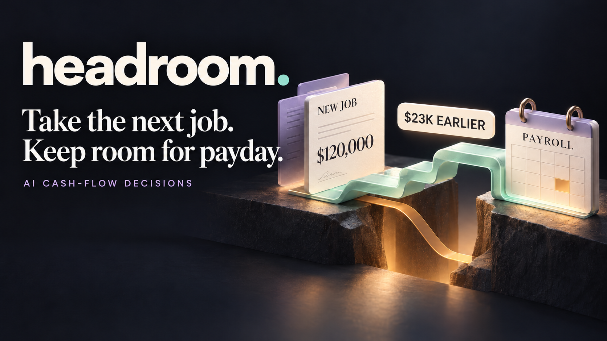

# Headroom brand pack

**Take the next job. Keep room for payday.**

Headroom is the space between opportunity and overextension: cash, time and evidence to take the next job with confidence. The name connects the owner's growth ambition to the reserve the product protects.

## Assets

| Asset | Use |
| --- | --- |
| [Cash-bridge thumbnail v2 — 1672 × 941 PNG](../../public/brand/headroom-thumbnail-v2.png) | Recommended Devpost cover, video thumbnail and README banner; connects the job, earlier cash and payroll |
| [Bright thumbnail alternative — 1672 × 941 PNG](../../public/brand/headroom-thumbnail-light-v2.png) | Warm ivory cover for a lighter presentation direction |
| [Thumbnail exploration and refinement prompts](thumbnail-prompts-v2.md) | Two built-in imagegen concepts and one targeted edit |
| [Hero banner — 1672 × 941 PNG](../../public/brand/headroom-banner.png) | GitHub, Devpost gallery, presentation cover and social preview |
| [Text-free scene — 1672 × 941 PNG](../../public/brand/headroom-scene.png) | Future film keyframe, adaptable slide background, alternate copy placement |
| [Transparent mark — 1254 × 1254 PNG](../../public/brand/headroom-mark.png) | Logo lockups, profile image, overlays; retain transparency |
| [Exact image-generation prompts](image-prompts.md) | Reproducible creative direction and future edits |

The images were generated with the built-in imagegen tool and inspected before use. The app's tiny SVG mark is a simplified native interpretation of the same stepped `h` concept. The artwork is a visual metaphor; product screenshots and measured charts remain separate evidence.

The v2 cover makes the reference case concrete: a $120,000 job, a cash gap, a $23,000 advance in payment timing, and payroll on the other side. The mint path represents the proposed terms; the amber alternative represents the cash shortfall. The $23k is moved from the final receipt into the deposit, not added to contract revenue. The dark direction matches the guided demo's ink, mint, lavender and amber palette. The original portal artwork remains available as an alternate brand asset.

## Visual direction

The current thumbnail uses a mint bridge between a job document and a payroll calendar, with an amber alternative dropping into the cash gap. This expresses the product's central action: change payment timing to create room for the next job. Use one connected story and generous space, rather than a field of dashboard decorations. The earlier portal artwork remains available in the asset table.

| Role | Color |
| --- | --- |
| Ink / backdrop | `#13151E` |
| Mint / proposed path | `#A1DECA` |
| Ivory / document surface | `#F5F2E9` |
| Lavender / evidence accent | `#B9AFF2` |
| Amber / timing risk | `#EFC58F` |

The landing page and guided presentation use Geist sans and Lora serif; the detailed workspace retains Manrope and IBM Plex. The project name is **Headroom** in prose and **headroom.** in the wordmark. Keep the two-line tagline intact when space permits.

## Team handoff

The next phase is a collaborative frontend, deck and motion pass. This change supplies the identity and assets; it does not claim the motion film has been rendered. Earlier Paper frames retain the Greenlight working name and should be relabeled when that phase begins. Keep engine-derived amounts and cash-path geometry when replacing illustrative artwork with product data.

Public repository: [ManagementMO/headroom](https://github.com/ManagementMO/headroom). Live demo: [headroom-lahacks.vercel.app](https://headroom-lahacks.vercel.app). Existing model, dataset and Sentry identifiers remain valid provenance under their original Greenlight names.
