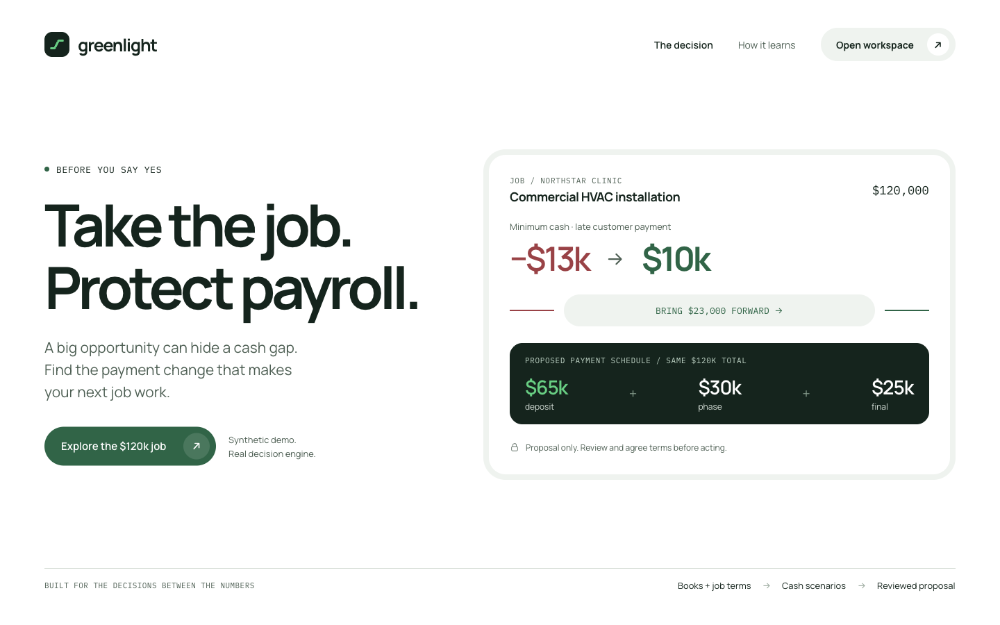
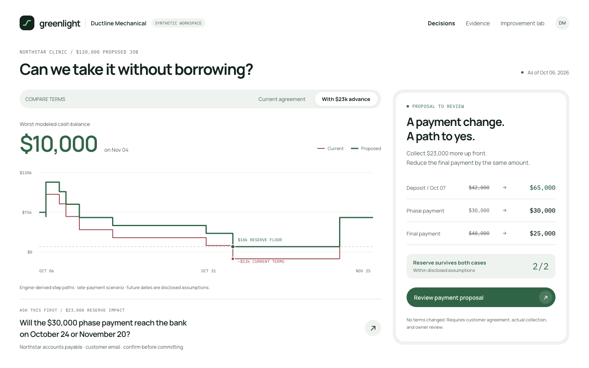

# Greenlight design and launch storyboard

[Open the editable Paper file](https://app.paper.design/file/01M56AKCMG8WN1327280QA4TJK) · [Complete design/motion handoff](HANDOFF.md) · [Offline gallery](index.html) · [Exact tokens](tokens.css)

These are authored design directions for the frontend team and a future launch film. They do not replace the current app or claim that a video has been rendered. The original Greenlight Paper file is untouched.

The new file contains **11 artboards across three pages**: four product directions, six frames for a 36-second film, and one design/motion specification. PNG and JSX exports succeeded; the native Paper PDF exporter returned assembly errors, so there is no PDF deliverable.

## Product direction

The idea is a **signal on a ledger**. Exact stepped cash paths explain the problem; a conserved payment transfer explains the remedy. The working surface stays focused on the owner's question, modeled minimum, source evidence and next review action. Ink-green scenes explain evidence and measured learning.

The cash paths come directly from the engine, not smoothed illustration. The $23,000 transfer changes $42k/$30k/$48k into $65k/$30k/$25k, preserving the $120k total. The proposed minimum is $10k in both declared cases, within the documented assumptions and agreement/collection requirements. [Numerical export](verified-cash-states.json)

The [evidence board](03-evidence-learning.png) and [mobile board](04-mobile-decision.png) preserve unknown, proposed and owner-review states. The clock illustration uses separate hypothetical October20 eligibility/October22 issuance/November5 due-date inputs; it must not overwrite the default fixture's actual illustrative dates or imply bank settlement.

## Launch story

| Time | Frame |
| --- | --- |
| 00–05 | [The $120k opportunity](film-01-opportunity.png) |
| 05–11 | [The hidden cash gap](film-02-hidden-gap.png) |
| 11–17 | [The four evidence clocks](film-03-evidence-clock.png) |
| 17–24 | [The conserved payment change](film-04-conserved-change.png) |
| 24–30 | [Learn behind fixed gates](film-05-learning-gates.png) |
| 30–36 | [A path to yes](film-06-path-to-yes.png) |

The learning frame uses the actual18→6-request experiment with unchanged20/21 correctness,15/21 decisive judgments and zero falseMET. It keeps the one-synthetic-workload limit visible. The v4 fine-tuning comparison was pending at design freeze; no quality gain is invented in these frames.

Use [HANDOFF.md](HANDOFF.md) for spoken lines, scene timing, easing, reduced motion, typography, spacing, implementation priorities and the evidence boundaries. The [JSX exports](jsx/) are design references; preserve the application's state, accessibility, hydration and financial logic when translating them.
